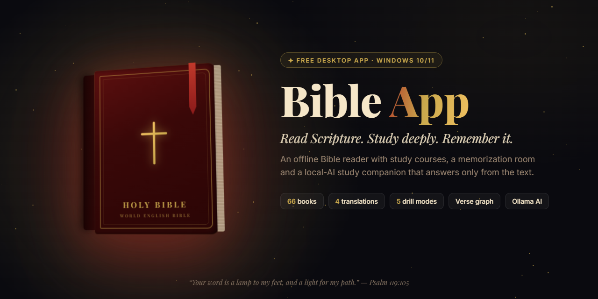
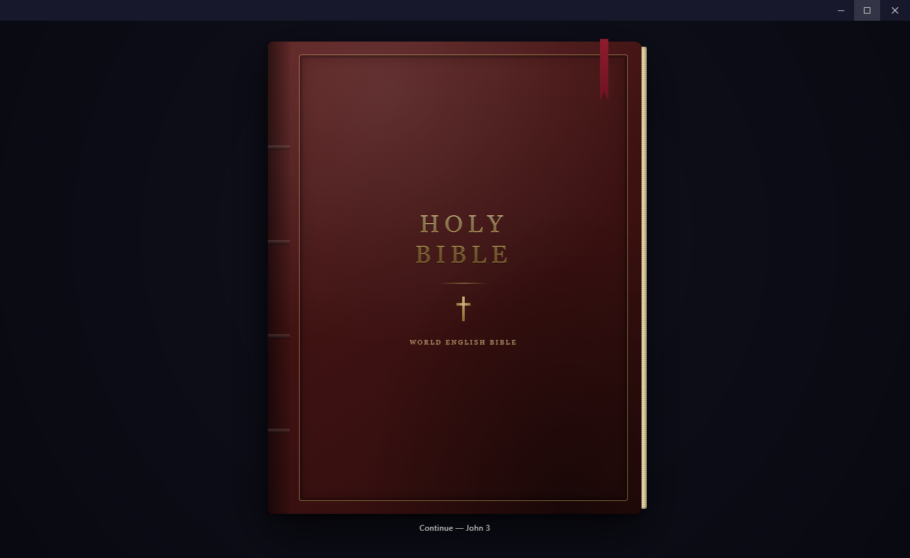
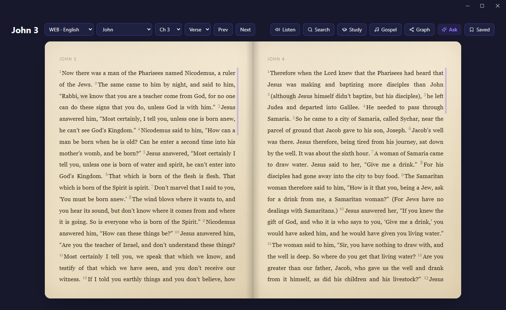
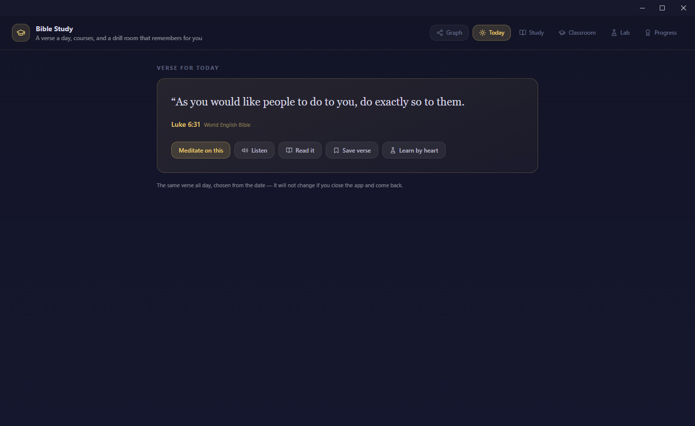
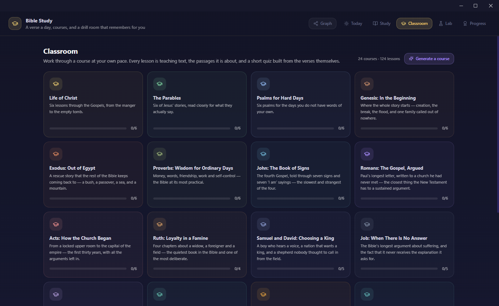
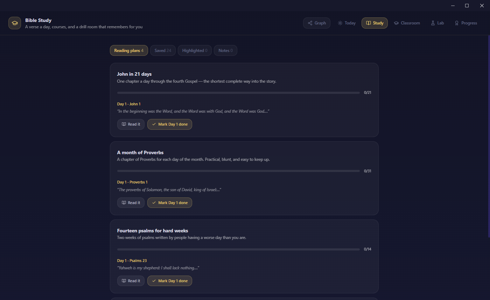
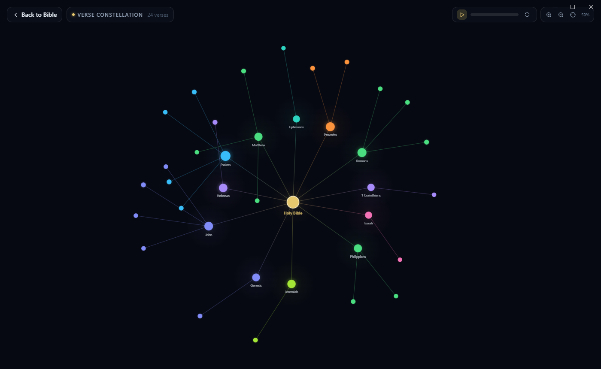

<p align="center">
  
</p>

<p align="center">
  <a href="https://github.com/pitchiluxe/bible-app/releases/latest"></a>
  <a href="https://pitchiluxe-bible.vercel.app"></a>
</p>

<p align="center">
  <a href="https://github.com/pitchiluxe/bible-app/releases/latest"></a>
  
  
  
  
</p>

---

**Bible App** is a free desktop Bible for Windows. It opens like a real book, keeps the whole Bible on your machine, and turns reading into a habit: a verse for each day, guided courses, reading plans, and a memorization room that brings each verse back just before you would forget it. An optional AI study companion answers questions using the bundled scripture only.

> “Your word is a lamp to my feet, and a light for my path.” — Psalm 119:105

## Contents

- [Screenshots](#screenshots)
- [Features](#features)
- [Download & install](#download--install)
- [AI study companion](#ai-study-companion)
- [Build from source](#build-from-source)
- [Project structure](#project-structure)
- [Releasing](#releasing)
- [Privacy](#privacy)

## Screenshots

<table>
  <tr>
    <td width="50%"></td>
    <td width="50%"></td>
  </tr>
  <tr>
    <td align="center"><b>The cover</b> — pick up where you left off</td>
    <td align="center"><b>The reader</b> — a two-page spread on paper</td>
  </tr>
  <tr>
    <td></td>
    <td></td>
  </tr>
  <tr>
    <td align="center"><b>Today</b> — one verse to meditate on, hear, save or learn</td>
    <td align="center"><b>Classroom</b> — 24 courses, 124 lessons</td>
  </tr>
  <tr>
    <td></td>
    <td></td>
  </tr>
  <tr>
    <td align="center"><b>Study desk</b> — reading plans, saved verses, highlights, notes</td>
    <td align="center"><b>Verse constellation</b> — your saved verses, grouped by book</td>
  </tr>
</table>

## Features

### 📖 Read
- **All 66 books, offline**, in four translations: World English Bible, Louis Segond 1910, and kids editions in English and French. References carry across languages, so a verse saved in French opens in English too.
- **A real book**: a leather cover that remembers your last chapter, and a two-page paper spread with Prev / Next and book, chapter and verse pickers.
- **Listen** to any chapter or verse read aloud.
- **Search** the full text, **highlight**, **save** verses and keep **notes** on them.
- **Gospel music** search for worship while you read.

### ☀️ Study
- **Verse for today**: the same verse all day, chosen from the date, so it is still there when you come back.
- **Classroom**: 24 courses and 124 lessons (Life of Christ, The Parables, Psalms for Hard Days, Romans, Job, and more). Each lesson has teaching text, the passages it covers, and a short quiz built from those verses. You can also **generate a course** on any topic.
- **Reading plans**: John in 21 days, a month of Proverbs, fourteen psalms for hard weeks, and more, with day-by-day progress.

### 🧠 Remember
- **The Lab** is a spaced-repetition drill room using a 5-box system. A verse moves up a box each time you recall it, and each box asks a bit more of you:

  | Box | Drill |
  |:---:|---|
  | 1 | Choose the real verse from four |
  | 2 | Fill in the missing word |
  | 3 | Recite from first letters only (`F__ G__ s_ l____ t__ w____`) |
  | 4 | Put the scrambled phrases back in order |
  | 5 | Type the whole verse from memory |

- **Progress** tracks your meditation streak, verses known by heart, lessons finished, and 34 badges.
- **Verse constellation**: a force-directed graph of everything you have saved, clustered by book. Press play to watch it build in the order you saved each verse.

## Download & install

1. Download **`Bible-App-<version>-Setup.exe`** from the [latest release](https://github.com/pitchiluxe/bible-app/releases/latest), or from the [website](https://pitchiluxe-bible.vercel.app).
2. Run it and choose where to install. No admin rights are needed.
3. The installer isn't code-signed yet, so Windows SmartScreen may show *“Windows protected your PC”*. Click **More info → Run anyway**.

The app checks GitHub Releases on startup, downloads new versions in the background, and installs them when you quit.

**Requirements:** Windows 10 or 11, 64-bit.

## AI study companion

Use **Ask** in the reader to ask a question. The app searches the bundled Bible for relevant passages and passes only those to the model. The model is told to quote nothing else, to cite every verse as `[Book 1:2]`, and to say so plainly when the passages don't answer the question. Answers come back in the language you're reading in.

| Provider | Setup | Notes |
|---|---|---|
| **[Ollama](https://ollama.com)** (default) | Install Ollama and pull a model, e.g. `ollama pull llama3.1` | Runs fully on your PC at `http://localhost:11434` |
| **[OpenRouter](https://openrouter.ai)** (fallback) | Add an API key in the app settings | Used only if Ollama isn't reachable |

Everything else in the app works without AI.

## Build from source

**Prerequisites:** Node.js 20+ and npm.

```bash
git clone https://github.com/pitchiluxe/bible-app.git
cd bible-app
npm install
npm run dev        # launch with hot reload
```

| Script | What it does |
|---|---|
| `npm run dev` | Start Electron with the Vite dev server on `localhost:5173` |
| `npm run build` | Compile main, preload and renderer into `out/` |
| `npm run preview` | Run the compiled build |
| `npm run package` | Build and create the Windows installer and zip in `dist/` |

## Project structure

```
bible-app/
├── src/
│   ├── main/            Electron main process: window, storage, AI, updater
│   ├── preload/         Safe bridge exposed to the UI as window.electronAPI
│   └── renderer/src/
│       ├── assets/bible/   Bundled scripture (WEB, LSG, kids editions)
│       ├── components/     Reader, study desk, classroom, lab, verse graph
│       └── services/       Bible lookup, quiz builder, spaced repetition, speech
├── landing/             Static download site (deployed to Vercel)
├── resources/           App icons
├── scripts/             Icon generator and README banner source
└── docs/                README images
```

**Stack:** Electron 44 · React 18 · TypeScript · Vite (electron-vite) · Tailwind CSS · Zustand · Framer Motion · d3-force · electron-builder / electron-updater

## Releasing

1. Bump `version` in `package.json`.
2. Build and upload to a draft GitHub Release:
   ```bash
   GH_TOKEN=$(gh auth token) npx electron-builder --win --publish always
   ```
3. Publish the draft. Installed apps pick it up through `latest.yml`.

The website at `landing/` deploys to Vercel on every push to `main`. Its download buttons point to `releases/latest`, so they need no change for a new version.

## Privacy

Your highlights, notes, saved verses, study progress and settings are stored as JSON files in `%USERPROFILE%\.bible-app`. There is no account and no telemetry. Network access is used only for update checks, gospel music search, and the AI provider you choose.

## License

[MIT](LICENSE) © My Digital Solutions

<p align="center"><sub>Built by <a href="https://github.com/pitchiluxe">Erick Omari</a> · <a href="https://erickomari.vercel.app">Portfolio</a></sub></p>
